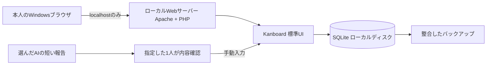
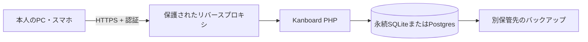
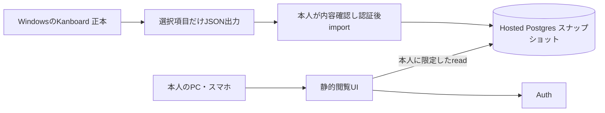

# 2. 全体構成

**失効した初版の参考資料（2026-10-11）**：この章は撤回済みのKanboard案を記録したもので、現行構成・採用決定・構築指示ではありません。最新の検討状況は [OSS再選定提案](oss-reselection-20261011.ja.md) を参照してください。Backlog.mdは第一候補の提案で、採用未承認・実機未検証です。

## Phase 1：既成OSSをそのまま使う

- 正本はKanboardのDB。チャットは根拠や相談の場として残し、全部は転載しない。
- Windows上の既存WSL2があれば、Linuxファイルシステム内にApache/PHP/SQLiteを置く。Windowsブラウザからlocalhostで利用できる。[S11, S12](08-sources.md)
- 既存の安全なWindowsネイティブIIS/PHPが使えるなら再利用候補。実機のWindows版・既存構成を確認してから決める。Windows導入記事には古い記述があり、コマンドをそのまま再利用しない。[S5](08-sources.md)
- 初版にDocker、Redis、別のDBサーバー、MCPサーバー、カスタムプラグインは不要。
- `data/` はWebから取得不可にし、DBをOneDrive同期フォルダ・ネットワーク共有へ置かない。WSLではLinux側の通常ディスクを使う。
- 起動/停止は明示操作。Windows停止中のローカル閲覧・更新はできない。

## Phase 2A：同じKanboardをホストへ移す（保守最小）

既存の常時稼働Linuxホストがあれば再利用し、なければVPS等が必要。小規模・単一ホストでは永続ローカルSQLiteを保てる。並列書込を増やす際はPostgresを再検討する。コンテナ化を選ぶ場合は現在のKanboard公式要件の注意に従い、SQLite前提のまま持ち込まない。[S3](08-sources.md)

切替後の正本はホストだけ。Windows版は書込停止してバックアップにし、二重の正本を作らない。ホストが稼働していればWindowsの電源に依存せず最新の看板を使える。ホスト代・バックアップ代等の0円は未確認であり保証しない。

## Phase 2B：認証付き読み取り専用スナップショット（追加月額0円を優先）

- 小さな閲覧UIは後続の追加開発。静的ホスト候補はVercelまたはCloudflare Pages、データ/認証候補はSupabase。
- 個人非商用の場合だけVercel Hobbyを候補にする。仕事用の看板を自動的にHobby対象と判断しない。[S13, S14](08-sources.md)
- タスクJSONを静的サイトの公開ファイルに同梱しない。非公開データはDBへ置き、Authと行アクセス制御で本人だけ取得できるようにする。
- 初期の同期は本人によるファイルimport。秘密を持つ常駐アップローダーは初期必須にしない。
- Windowsを停止しても最後に取り込んだ情報は読める。ただしその後のローカルタスク更新は反映されない。Free DBの休止・障害もあり、常時閲覧保証ではない。[S17, S18](08-sources.md)
- 通常閲覧はタスクを編集しない。importは別の管理操作で、書込できるのは本人のスナップショット領域だけ。
- 履歴・承認原文・添付ファイル・秘密は原則クラウドへ送らない。表示に必要な短い要約とアクセス権を変えない証跡リンクだけ。

## AIとの接続境界

Phase 1では人手。Phase 1.5以降、実際に接続可能で許可された環境からKanboardの公開JSON-RPC APIを利用する。遠隔AIがWindowsのlocalhostへ直接到達できるとは想定しない。必要な場合は本人のPC上の許可された作業経路を使う。到達できなければ転記用の更新案を返す。

ChatGPT/dotのすべての会話、内部タスク、実行状況を自動取得できるAPIの存在は前提にしない。GitHub等の取得可能な根拠も対象を絞る。看板からAI処理を起動する機構は別計画。
