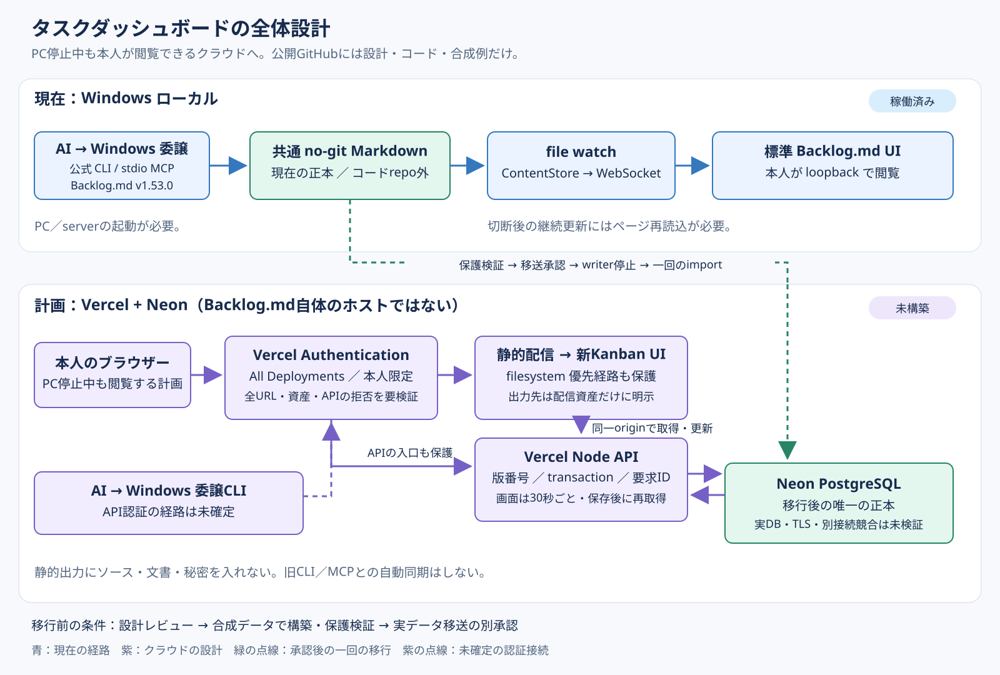
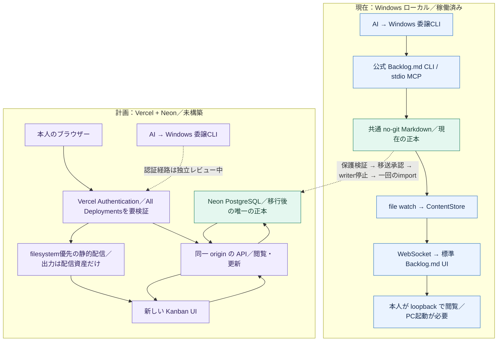

# 12. PC停止中にも使えるタスクダッシュボードの全体設計

更新日：2026-10-12。**このページはクラウド版の設計です。Vercel／Neonの実構築は、設計レビューとマージの後に行います。** 公開リポジトリには実タスク・秘密・私的な記録を入れません。

## まず押さえること

現在のWindows版は、公式 **Backlog.md v1.53.0 のCLI／MCP／標準Web画面**を使っています。共通のno-git Markdownが正本です。私的タスクはローカルに取り込み済みですが、内容はこのリポジトリに含めません。PCを停止すると、その画面は利用できません。

次のクラウド版は、**Backlog.md自体をVercelへホストする構成ではありません。** Vercelに新しいKanban UIとAPIを置き、Neon PostgreSQLを正本にします。PCを停止しても本人がクラウドの一覧を見られることを目指します。WindowsのAI更新経路は別に残せますが、PC停止中にWindows上のagentが実行されるわけではありません。

| 項目 | 現在：Windowsローカル版 | 計画：非公開クラウド版 |
|---|---|---|
| 画面 | Backlog.mdの標準Web UI | 新しいKanban UI。既存画面の見やすい整理を引き継ぐ |
| 正本 | 共通no-git Markdown。コードrepo外 | Neon PostgreSQL。Vercelのディスク／メモリは正本にしない |
| 更新 | 公式CLI／stdio MCPへWindows上で委譲 | 認証済みAPIへの更新。AI用CLIの認証経路はレビュー中 |
| 閲覧 | loopback。PCとローカルserverの起動が必要 | Vercelの本人認証後に閲覧。PCの起動に依存しない |
| 画面への反映 | file watch→WebSocket→標準画面の再取得 | MVPは可視時30秒ごとの再取得＋保存後の再取得 |
| 古い入力 | 公式lockは期待revisionのCASではない | タスクの期待版番号が不一致なら409で拒否する設計 |
| 公開状況 | ローカルのみ。私的データは公開しない | 未構築・未deploy・未移行。一般公開はしない |

ローカル版の詳細は[Backlog.md MVP構成](09-backlog-md-architecture.ja.md)、既知の再接続制限は[検証記録](11-validation-20261011.ja.md)を参照してください。

## 全体構成図



[静的図を大きく開く](images/cloud-architecture.svg)。青い実線は現在、紫の実線はクラウドの設計、点線は承認後の移行または未確定の接続です。図に実タスクや資格情報は含みません。

GitHubで拡大・追跡しやすいMermaid版：



## 画面で維持すること・変わること

維持するのは、6状態の列（未着手／進行中／承認待ち／中断・保留／検証中／完了）、現行／要棚卸し／完了履歴の表示グループ、タイトル・主担当・詳細・更新日時・確認日時、検索、接続状態と最終取得日時が分かる表示です。画面の取得日時は仕事を確認した日時と区別します。中断や通信断を仕事の完了に変換しません。

新UIはBacklog.mdのUIをコピーしたものではありません。標準UIと同一の機能・操作・見た目は保証しません。Markdown編集、標準検索の全機能、各種編集機能、既存リンクの互換性も自動では引き継ぎません。最初は一覧・検索・詳細閲覧・状態更新に絞り、合成データで比較してから必要な機能を追加します。

MVPは可視時に30秒間隔で最新データの取得を試みる設計です。通信や無料枠の停止を含む反映時間は保証しません。ローカル版の「保存から10秒未満」の目標をクラウド版の実績として引き継ぎません。[Vercel Services](https://vercel.com/docs/services)と[WebSocket](https://vercel.com/docs/functions/websockets)は現在全プランでBeta対応しています。将来の即時通知も可能ですが、今回は接続延命と複数instance間の通知を増やさず、まず耐久保存とアクセス保護を検証します。

## 本人認証と保護の境界

**既存のVercelログインを使い、本人限定のVercel Authentication＋All Deploymentsを採用する方針です。追加Basic認証は採用しません。** 別ブランチの候補に含まれるBasic認証は旧案であり、この設計に合わせた実装修正は次段階です。

[公式Deployment Protection](https://vercel.com/docs/deployment-protection)では、Standard Protectionはproduction domainを除外します。今回は **All Deployments** を対象にし、production alias・preview・deployment URL・必要ならcustom domain、その下のページ／JS／CSS／APIまで確認します。All DeploymentsのVercel Authenticationは有料add-on不要と公式に記載されていますが、実プロジェクト上での適用と拒否応答は未確認です。

[Vercel Authentication](https://vercel.com/docs/deployment-protection/methods-to-protect-deployments/vercel-authentication)は、権限を持つteam/project memberやaccess group、明示的にアクセスを許可された人なども通過できます。「ログイン済み」だけで「本人だけ」とは限りません。対象プロジェクトのメンバー・アクセス許可を本人だけに限定し、本人以外のmember／access group／外部アクセス許可、共有リンク、保護bypass、Trusted Sources、保護例外がないことを確認します。設定の値や環境変数だけで保護を証明せず、Production／Preview／生成URL／独自domainのすべてと各ページ・資産・APIを未認証で試験します。

認証は入口のアクセス制御、API側の入力検証・版番号チェック・更新権限は別の責務です。呼出側が自由に送れる「認証済み」「本人メール」や`x-vercel-*`ヘッダーを本人確認の根拠にしません。DB接続情報はサーバー側の秘密環境変数だけに置き、ブラウザーへ返しません。保護設定が失われた場合にAPIが閉じる仕組みもレビューと実機試験の対象です。

### 静的配信も保護の対象にする

catch-all rewriteだけでは、先に見つかった静的ファイルの配信を制御できない可能性があります。特にOther presetの既定出力がrepo rootになると、コードや文書まで静的出力に含まれるおそれがあります。これは[公式output directory仕様](https://vercel.com/docs/builds/configure-a-build#output-directory)と[rewrite／filesystemの優先関係](https://vercel.com/docs/project-configuration/vercel-json#rewrites)からの推論で、現候補の実buildで露出を実証したものではありません。

次段階では**公開出力先を`dist/public`など配信資産だけの専用directoryに明示**し、repo rootを出力先にしません。APIはFunctionとして分離してbundleし、静的出力はbuild後にファイル一覧を検査します。ソース・設計文書・テスト・秘密・私的データを出力へ入れず、filesystem優先の静的経路とFunction経路の両方がVercelの入口保護を通ることを実build／HTTPで検証します。図の静的経路はこの確認対象です。

本人のブラウザーは同一originのAPIを使う設計です。AIがAPIを呼ぶ認証方法は未確定で、Vercelのログイン用cookieをCLIへコピーすることやbypass tokenの発行を既定にしません。認証済みのAI更新経路が決まるまで、その経路を稼働済みと扱いません。dotはWindows委譲CLIを使う想定であり、API／MCPの存在がdotとの直結を意味するわけではありません。

## 保存・更新・再接続

96件規模を含む小規模利用向けの候補は、PostgreSQLの一行のJSONBにタスクと更新結果を持たせる構成です。現候補は1000タスクを上限にしています。Node側のDBライブラリ候補は`pg` 8.23.1（[公式upstream](https://github.com/brianc/node-postgres)）。バージョン・lockfile・取得物・実接続は構築前に固定して検証します。

| 処理 | 設計 |
|---|---|
| 閲覧 | APIが正本DBを読み、タスク一覧と取得時刻を返す。画面はキャッシュを正本にしない |
| 更新 | 読んだタスクの版番号を期待値として送る。1 task 1主担当を保持する |
| 同時更新 | 同一DB接続でBEGIN→SELECT FOR UPDATE→変更→COMMIT。版が古ければ409、上書きしない |
| 再送 | 要求ID・内容の指紋・結果を同じtransactionに保存。同一要求は同じ結果、異なる内容の同一IDは拒否 |
| 保持範囲 | 現候補は直近1000要求・1000監査イベント。範囲外の再送には過去結果の返却を保証しない |
| 中断復旧 | 最新状態を再取得。保存結果不明なら同じID／内容で照合・再送し、新IDで二重実行しない |
| 接続切断 | 最後の取得データと切断表示を残す。復旧後にDBから再取得する |

主担当の表示はagent別の認証・RBACとは別です。最初は本人専用を前提にし、agentごとの権限管理・資格情報・監査主体の識別は未確定として残します。

## 単一正本への移行と戻し方

ローカルとクラウドを同時に書ける二重正本にはしません。移行の順番は次のとおりです。

1. 設計をレビュー・マージし、無料条件と利用範囲を確認する。
2. Vercel／Neonを準備し、**合成データだけ**で構築・認証・保存・競合・再取得を検証する。
3. 全URLで未認証アクセスを拒否し、本人の閲覧・更新だけが成功することを確認する。
4. 実タスクのクラウド移送について、保護検証後に別途承認を得る。
5. ローカルCLI／MCPのwriterを停止し、私的backup/exportをrepo外に作る。件数・状態・担当・詳細・確認日時を照合する。
6. 空のDBへ一回のtransactionでimportし、移行前後を照合する。必要な情報を落とすimportは合格にしない。
7. Neonを唯一の正本にする。Backlog Markdownは読み取り専用snapshotとして扱い、公式CLI/MCPでの旧正本更新を再開しない。

取り込み時刻と元の更新・確認時刻を区別します。現在の候補importは正規化が必要で、Backlog形式との自動互換性を保証していません。私的状態、保留理由、出所などをどの項目へ保存するかの対応表と検証を、実移行前に用意します。

クラウドへ更新した後は、古いローカルsnapshotをそのまま再開しません。クラウドwriterを止め、最新を私的exportし、差分を照合してから次の唯一の正本を決めます。DB喪失への復旧には別のprivate backupが必要です。無料プランのbackup／restore保持条件と手動export手順も、実移行前に検証します。

## 無料枠と制約

追加の有料契約・カード登録・有料upgrade・自動課金は行いません。2026-10-12に、接続先のVercelはHobby active、Neon Marketplaceは`free_v3`、`paymentMethodRequired:false`、無料枠超過時は制限／休止で自動有料化なしと確認されています。これは確認時点の条件で、永久保証ではありません。構築時に再確認し、料金ページの古い数値を固定しません。

[Vercel Hobby](https://vercel.com/docs/plans/hobby)は個人・非商用用途限定です。私的な本人専用でも事業利用なら条件確認が必要で、公開repoがOSSであることだけで適格とは判断しません。無料条件に合わない場合は構築を止め、追加費用なしの代替を検討します。無料枠の停止は「PC停止中でも常に利用できる」という保証を弱めます。

Vercel／Neonを作る際の規約と連携、DB接続資格情報は構築段階で扱います。秘密値はGitへ入れず、DBの初期化権限と実行時の最小権限を分けます。firewall／VPN設定を変更する構成ではありません。私的データの公開や第三者への招待はこの設計に含みません。

## 実装状況と未検証事項

このPRは文書と図だけです。別ブランチにUI/APIの候補がありますが、独立レビュー中であり、本番完成ではありません。候補は合成データのみで以下を試験しました。

| 種類 | 確認できたこと | 保証していないこと |
|---|---|---|
| loopback実HTTP＋test用ファイル保存 | 状態4段階、版の競合・再送、サーバー再作成後の保持、候補のアプリ認証拒否 | 実PostgreSQL、Vercel、最終認証方式 |
| 模擬Postgres client | 同一clientでのlock／commit／rollback呼出し | DBの実ロック、別instance同時更新、TLS接続 |
| 模擬request／response | platform相当のbody解析済み入力とrewriteの経路 | Vercelのbuild・配置・実routing |
| loopback実HTTP＋模擬DOM | app.jsの一覧反映・文字表示・切断表示・復旧取得 | 実ブラウザーの表示品質・モバイル操作・視覚QA |

本番で未検証なのは、Vercelの全URL保護と本人限定、保護欠落時のAPI閉鎖、AI更新の認証経路、依存取得と`pg`のlockfile、buildと静的assetsだけの出力、実DB／TLS／別接続同時更新／commit後永続化／backup、私的データの項目対応・移行、実画面の操作です。

独立レビューでは、カードを再表示すると保留中の要求IDが消える再送UXの問題が実証されました。版競合の拒否はあるものの、画面操作全体で「同じIDで再送」を保証できていません。要求ID・未確認結果を再表示後も保持する修正と操作試験が、次段階の導入条件です。上の再送表は目標設計であり、候補実装の完成保証ではありません。

候補のローカル試験は5 PASS。別の独立合成レビューは8 PASS／1 SKIPで、その実HTTPはEACCESにより実行できず、実DBもありません。これらを足して本番の合格件数としたり、実HTTP・実DBの検証済みと扱ったりしません。候補をそのまま稼働・実移送に使うことは不可とし、実装修正はこの文書PRの後に行います。

既に再現したnpm取得のTLS失敗は、検証を弱めて回避しません。同条件の取得試行を繰り返さず、依存を安全に取得できる環境が決まるまで構築の阻害要因として残します。別ブランチの候補コード・内部レビュー記録・私的テスト結果は、この文書PRに混ぜません。

## コードの置き場所（候補、今回のPRには含まない）

```text
api/                 Vercelの入口
cloud/public/        新しいKanban UI
cloud/               API・入力検証・PostgreSQL adapter・委譲CLI・移行補助
cloud/tests/         合成HTTP／模擬DB／DOM試験
scripts/             現在の公式Backlog.mdローカル起動・更新
docs/                現行／計画の設計と公開可能な図
```

関連資料：[日本語README](../README.ja.md)／[ローカルMVP](09-backlog-md-architecture.ja.md)／[AI更新プロトコル](10-agent-update-protocol.ja.md)／[既知の制限](11-validation-20261011.ja.md)。
