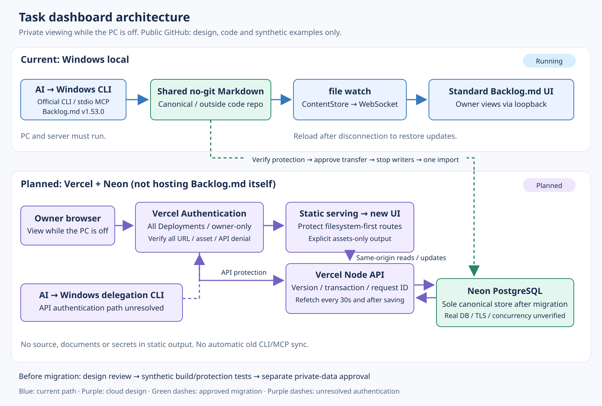
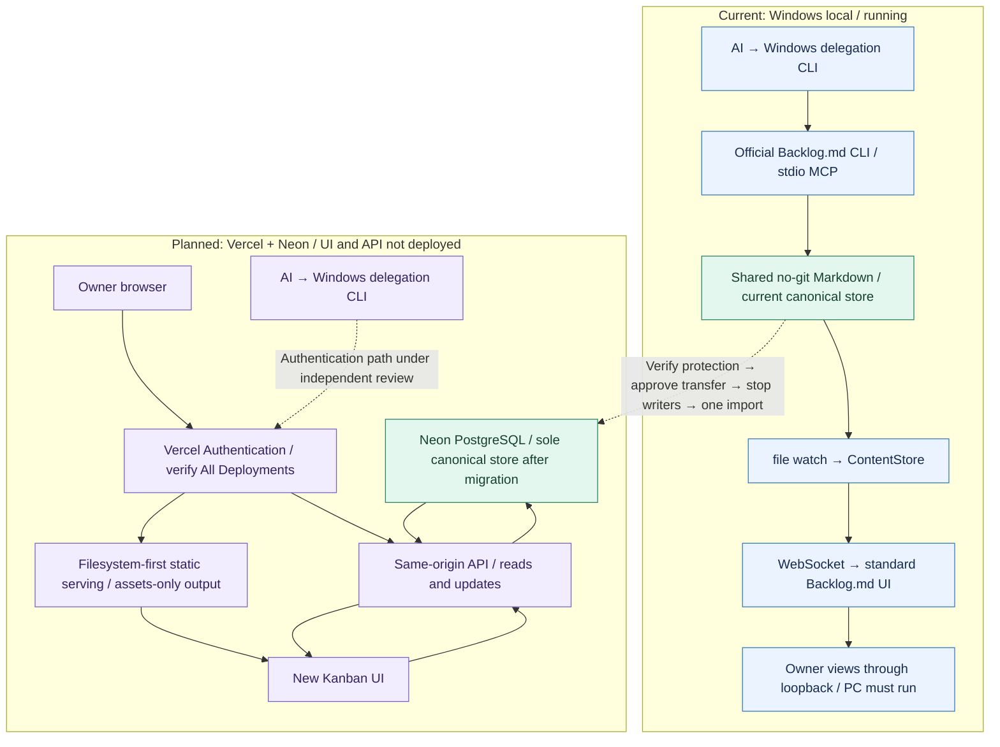

# 12. Overall design: a task dashboard that can be viewed while the PC is off

Language: **English** | [日本語](12-cloud-architecture.ja.md)

Updated: 2026-10-12. **This page describes the cloud design. The initial design has been merged, and setup preparation is in progress. The Neon resource's Free plan and Available status are confirmed, but its region, project connection and real DB connectivity remain unverified. The UI/API has not been deployed.** The public repository contains no live tasks, secrets or private records.

## Start here

The current Windows implementation uses the official **Backlog.md v1.53.0 CLI, MCP and standard web UI**. Shared no-git Markdown is the canonical store. Private tasks have been imported locally, but their contents are absent from this repository. Its dashboard is unavailable when the PC is off.

The planned cloud implementation **does not host Backlog.md itself on Vercel**. It puts a new Kanban UI and API on Vercel and uses Neon PostgreSQL as the canonical store. The goal is for the owner to view the cloud list while the PC is off. A Windows AI update path can remain, but Windows agents do not run when that PC is off.

| Item | Current: Windows local | Planned: private cloud |
|---|---|---|
| UI | Standard Backlog.md web UI | New Kanban UI retaining useful organization |
| Canonical store | Shared no-git Markdown outside the code repository | Neon PostgreSQL; Vercel disk and memory are not canonical |
| Updates | Official CLI / stdio MCP delegated on Windows | Authenticated API updates; AI CLI authentication is under review |
| Viewing | Loopback; PC and local server must run | Owner logs in through Vercel; viewing does not depend on the PC |
| Refresh | File watch → WebSocket → standard UI refetch | MVP: refetch every 30 seconds while visible and after saving |
| Stale input | Official locks do not provide expected-revision CAS | Reject mismatched expected task versions with HTTP 409 |
| Release status | Local only; private data is not published | Setup preparation; UI/API not deployed, private data not migrated; no general public release |

See the [local MVP architecture](09-backlog-md-architecture.ja.md) and [known reconnect limitations](11-validation-20261011.ja.md), both in Japanese.

## Overall architecture



[English static diagram](images/cloud-architecture.en.svg) / [日本語の図](images/cloud-architecture.svg). Solid blue lines show the current path; solid purple lines show the cloud design. Dashed lines show an approved future migration or an unresolved connection. The diagram is a target architecture, not evidence that resources are connected or running. It contains no live tasks or credentials.

Mermaid version for GitHub:



## What the UI retains and changes

Retained concepts are six status columns (To Do, In Progress, Awaiting Approval, Blocked, Verifying, Done); the Current, Needs Review and Completed History display groups; title, primary owner, details, update time and confirmation time; search; and connection status and last-fetch time. Fetch time is distinct from when the work was confirmed. An interruption or network failure does not mark work as complete.

The new UI is not a copy of Backlog.md's UI. Identical features, interactions and appearance are not promised. Markdown editing, all standard search features, other editing functions and existing-link compatibility are not automatically carried over. The first version focuses on lists, search, detail viewing and status updates. Compare it using synthetic data before adding needed features.

The MVP attempts a refetch every 30 seconds while visible. Refresh latency, including network delays and free-tier suspension, is not guaranteed. The local target of less than 10 seconds from save to display is not a measured cloud result. [Vercel Services](https://vercel.com/docs/services) and [WebSockets](https://vercel.com/docs/functions/websockets) are currently in Beta on all plans. Instant notifications are a possible later extension; first verify durable storage and access protection without adding connection renewal and cross-instance notification infrastructure.

## Owner authentication and the protection boundary

**Use the existing Vercel login with owner-only Vercel Authentication and All Deployments. Additional Basic authentication is not adopted.** Basic authentication has been removed from the old candidate. Real Vercel protection tests are a later setup step.

According to the [Deployment Protection documentation](https://vercel.com/docs/deployment-protection), Standard Protection excludes production domains. The intended scope is **All Deployments**, covering production aliases, previews, generated deployment URLs and any custom domains, including pages, JS, CSS and APIs beneath them. The documentation states that Vercel Authentication for All Deployments needs no paid add-on. Its application and denial responses on the actual project remain unverified.

[Vercel Authentication](https://vercel.com/docs/deployment-protection/methods-to-protect-deployments/vercel-authentication) also allows appropriately authorized team/project members, access groups and explicitly granted users. Logged in does not necessarily mean owner-only. Restrict project membership and access to the owner; verify that there are no other members, access groups, external grants, shareable links, bypasses, Trusted Sources or protection exceptions. Configuration values and environment variables do not prove protection. Test every Production, Preview, generated and custom-domain URL, including pages, assets and APIs, without authentication.

Authentication belongs to Vercel's outer boundary; the business handler does not add its own authentication decision. API input validation and version checks are separate responsibilities. Caller-controlled authenticated/user-email or `x-vercel-*` headers and environment values such as `VERCEL=1` are not identity evidence. Database credentials stay in server-side secret environment variables and are not returned to the browser. **Disabling Vercel protection can expose the UI and API. The application does not guarantee automatic closure.** HTTP 503 for missing database/settings or connection failure is not authentication.

The deployment gate requires checking control-plane `ssoProtection.deploymentType=all` and access scope, then testing unauthenticated rejection for every URL, asset, API, direct Function and POST. Browser POSTs require an Origin that exactly matches the configured origin. Origin alone does not identify the owner.

### Protect static serving too

A catch-all rewrite may not control static files found earlier in routing. In particular, the Other preset can use the repository root as output, potentially exposing code or documents. This is an inference from the [output-directory specification](https://vercel.com/docs/builds/configure-a-build#output-directory) and [rewrite/filesystem precedence](https://vercel.com/docs/project-configuration/vercel-json#rewrites), not a demonstrated exposure from a real candidate build.

Explicitly set the **public output to a dedicated assets-only directory such as `dist/public`**, not the repository root. Bundle the API separately as a Function and inspect the static output file list after building. Exclude source, design documents, tests, secrets and private data. Real build/HTTP tests must verify that both filesystem-first static serving and Function routing pass through Vercel's outer protection. The diagram includes that static route as a verification target.

The owner browser uses same-origin APIs. AI API authentication remains unresolved: copying Vercel login cookies to the CLI or issuing bypass tokens is not the default. Do not claim the AI update path is running until its authentication is settled. dot is expected to use Windows delegation CLI; the existence of an API or MCP does not prove a direct dot connection.

## Storage, updates and reconnection

For small-scale use, including roughly 96 tasks, the candidate stores tasks and update results in one PostgreSQL JSONB row. Its current limit is 1,000 tasks. The proposed Node database library is `pg` 8.23.1 ([official upstream](https://github.com/brianc/node-postgres)). Pin and verify the version, lockfile, downloaded artifacts and real connection before deployment.

| Operation | Design |
|---|---|
| Read | API reads the canonical DB and returns tasks and fetch time; the UI cache is not canonical |
| Update | Send the version read as the expected version; retain one primary owner per task |
| Concurrent update | Use one DB connection for BEGIN → SELECT FOR UPDATE → change → COMMIT; return 409 for stale versions instead of overwriting |
| Retry | Store request ID, content fingerprint and result in one transaction; the same request returns the same result, while changed content under the same ID is rejected |
| Retention | Candidate keeps the latest 1,000 requests and 1,000 audit events; older requests are not guaranteed their historical response |
| Interrupted operation | Refetch; if save outcome is unknown, reconcile/retry the same ID and content instead of creating a new ID |
| Disconnection | Retain the last snapshot and show the disconnected state; refetch the DB after reconnecting |

Displaying a primary owner is separate from per-agent authentication/RBAC. Start with owner-only use. Agent-specific permissions, credentials and audit identity remain unresolved.

## Migration to one canonical store and rollback

Do not allow local and cloud stores to accept simultaneous authoritative writes. Migration order:

1. Review and merge the design; confirm free-plan conditions and permitted use.
2. Prepare Vercel/Neon and verify build, authentication, storage, conflicts and refetching with **synthetic data only**.
3. Verify unauthenticated rejection across every URL and successful reads/updates only for the owner.
4. Obtain separate approval to transfer private tasks after protection verification.
5. Stop local CLI/MCP writers. Create private backup/export outside the repository and compare counts, statuses, owners, details and confirmation times.
6. Import once into an empty DB in one transaction and compare before/after. An import that loses required information does not pass.
7. Make Neon the sole canonical store. Treat Backlog Markdown as a read-only snapshot and do not resume official CLI/MCP writes to the old canonical store.

Distinguish import time from original update/confirmation times. Candidate import requires normalization and does not promise automatic Backlog-format compatibility. Before real migration, define and verify a mapping for private state, pause reasons, sources and other required information.

After cloud writes begin, do not simply resume an old local snapshot. Stop cloud writers, privately export the latest state, reconcile differences, then choose the next sole canonical store. Database loss requires a separate private backup. Verify free-plan backup/restore retention and manual export procedures before migration.

## Free tiers and constraints

Do not add paid contracts, payment cards, paid upgrades or automatic charges. Read-only checks on 2026-10-12 confirmed Vercel Hobby active and the Neon Marketplace catalog's `free_v3`, `paymentMethodRequired:false`, and restriction/suspension rather than automatic paid conversion after free limits. The Neon resource's Plan Free and Status Available were subsequently confirmed. Its region, Vercel project connection and real DB connectivity remain unverified; Free/Available does not prove a completed connection. Recheck during setup rather than freezing old pricing-page numbers.

[Vercel Hobby](https://vercel.com/docs/plans/hobby) is restricted to personal, non-commercial use. An owner-only private tool used for business still needs eligibility checking; an OSS public repository does not by itself qualify it. Stop setup and consider a no-additional-cost alternative if the conditions do not fit. Free-tier suspension limits any promise of continuous availability while the PC is off.

Handle Vercel/Neon terms, integration and DB connection credentials during setup. Keep secrets out of Git; separate initialization rights from least-privilege runtime rights. The design does not change firewall/VPN settings, publish private data or invite third parties.

## Implementation status and unverified work

This PR contains only documents and diagrams. The UI/API candidate is on another branch under review and is not a production-ready system. Only synthetic data was used for the following tests.

| Type | Verified | Not guaranteed |
|---|---|---|
| Real loopback HTTP + test file store | Four-stage lifecycle, conflicts/retries, retention after server recreation, missing-setting 503 and strict Origin | Real PostgreSQL or Vercel Authentication |
| Mock PostgreSQL client | Same-client lock/commit/rollback calls | Real DB locking, cross-instance updates or TLS |
| Mock request/response | Platform-like pre-parsed body and rewrite path | Real Vercel build, packaging or routing |
| Real loopback HTTP + mock DOM | app.js list updates, literal text, disconnection display and recovery fetch | Real browser/mobile interactions or visual QA |
| Real loopback HTTP + mock DB connector / synthetic store | Production entry's store wiring and connection-failure 503; synthetic-only local loopback startup | Real DB connection, outer authentication or private data |
| Local file build | Explicit HTML/JS/CSS-only output and rejection of unknown files | Vercel packaging, deployment or all-URL protection |

Unverified production work includes owner-only protection across all URLs/direct Functions/POSTs; AI authentication; dependency acquisition and the `pg` lockfile; Vercel build and assets-only output; real DB/TLS/separate-connection concurrency/post-commit durability/backup; private-field mapping/migration; and real UI interaction. Automatic application closure after protection is disabled is not adopted; security depends on maintaining Vercel protection.

The request-ID loss on card reopen demonstrated by independent review has been fixed in the separate candidate using a per-task Map. Synthetic HTTP/mock-DOM tests pass for the same ID/body through write 503, post-commit ACK loss, another task's operation and reopening the card. Real browser behavior is unverified. The Map does not survive full-page reload or tab closure. The retry table is the target design, not a guarantee of full interruption recovery.

The initial candidate's local tests passed 5 cases; the revised candidate passes 12. A separate independent synthetic review passed 8 and skipped 1; its real HTTP test could not run because of EACCES, and it had no real DB. Do not add these counts into production test results or claim real Vercel authentication/DB verification. Do not run the candidate with private data until deployment gates pass.

Do not weaken TLS verification to work around the reproduced npm acquisition failure. Do not repeat the same acquisition attempt; retain it as a blocker until a safe dependency source/environment is available. Candidate code, internal review records and private test artifacts are excluded from this documentation PR.

## Proposed code locations (not included in this PR)

```text
api/                 Vercel entry
cloud/public/        New Kanban UI
cloud/               API, validation, PostgreSQL adapter, delegation CLI, migration helpers
cloud/tests/         Synthetic HTTP, mock DB and DOM tests
scripts/             Current official Backlog.md local launch/update scripts
docs/                Current/planned design and public diagrams
```

Related: [English README](../README.md) / [日本語README](../README.ja.md) / [日本語の設計](12-cloud-architecture.ja.md) / [local MVP](09-backlog-md-architecture.ja.md) / [agent update protocol](10-agent-update-protocol.ja.md) / [known limitations](11-validation-20261011.ja.md). The three earlier implementation references are in Japanese.
